# OPEN-3: the opening, bug by bug

The opening is **real-time** (in-engine, `src/game/story/opening.js` on `src/engine/cinematic.js`); there is no
pre-rendered video. Every fix below is a change to that scene and is re-captured from the game itself.

## How it was watched

- `capture.mjs` (this folder) plays a new game's opening on the game's own clock: deterministic 1/30 s steps,
  i.e. the picture at normal speed, with no frames dropped by the slow software renderer. It saves a page screenshot
  (subtitles, captions, the fade and the title included) every 0.2 s at 1280×720 and every 0.25 s at 960×540, plus a
  per-frame log of every actor: position, facing, animation, the feet's height over the floor, the hands, and every
  collider the actor's body overlaps.
- `analyze.py` reads that log: solids crossed, feet floating or sinking, sliding, jumps between frames.
- Revision: `origin/ccr-adf00ea7-37ebl3` at 533d0b5 (after BUG-WALL), headless Chromium, SwiftShader (ANGLE), the
  default quality, DPR 1. The same scene on a real GPU is not verified here.
- Not possible here: listening. The voices (gibberish babble, voice.js) and the music cue were not heard; their
  timing was checked against the subtitles and the shot list only (BLOCKED for "by ear").

Times are scene seconds. Crops: `crops/NN-before.jpg`, `crops/NN-after.jpg` (same moment after the fix).
Status: **FIXED** (re-captured, committed on its own) · **NEEDS-MODEL** (character model or rig: for routing) ·
**NEEDS-WORLD** (a world asset outside the opening's files) · **OPEN** (not done yet) · **NOT A BUG** (checked).

## The list

| # | Time | Shot | Who | Problem | Cause | Status |
|---|---|---|---|---|---|---|
| 01 | 11.6–13.0 | 1 air → harbour | camera | The dive to the harbour skims the coal shed's roof and the blue booth (they fill a quarter of the frame), then cuts mid-dive to the lift. 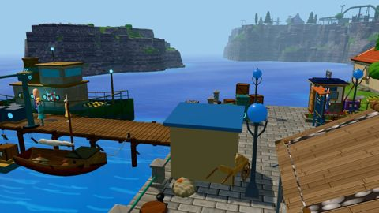 | Shot 1b ends low (5.6 m) right over the quay's buildings, still moving at speed when the cut comes. | OPEN |
| 02 | 12.0–13.0 | 1 | — | A grey block hangs in the air over the water right of the pier. 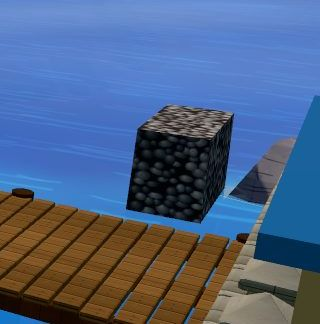 | A mesh of the world's `harbour` group at (-122.3, 1.1, 35.8) (island.js), not part of the scene. | OPEN |
| 03 | 14.6–19.6 | 2 the lift | resident, worker | The resident asks with his back half to us and one arm stuck out at nothing; the worker faces the lens, not the man talking to him. 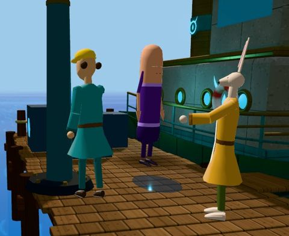 | The worker is turned to the lift column until 16.85; the generic talk gesture picks a random arm swing. | OPEN |
| 04 | 13–29 | 2, 4 | Doran | Doran stands frozen right behind the worker in every pier shot, staring ahead; at 24–29 his head is cut by the frame. 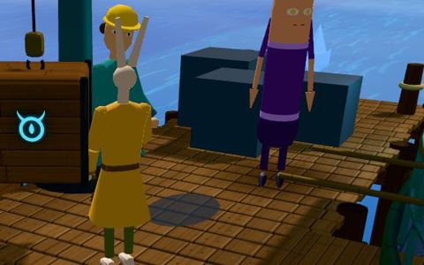 | An ambient NPC left where he stands; nobody gives him a reason to be there. | OPEN |
| 05 | 23.8–28.6 | 4 the pier again | worker, Doran | Heads cut by the top of the frame. 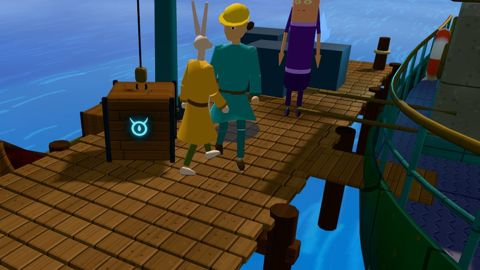 | Shot 4 is high and looks down at 1.25 m: the people near the lift are at the top edge. | **FIXED**: the camera 0.25 m lower and its look point on the people (0.7 m over the deck, it was under it): heads, the lift's hook and Doran are in frame for the whole shot. 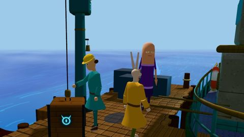 |
| 06 | 26.3–26.9 | 4 | resident, worker | The resident walks through the worker (0.39 m centre to centre). 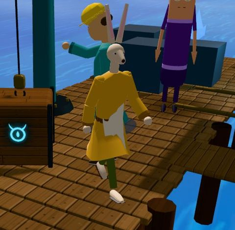 | Their two walks cross at the same moment. | **FIXED**: the worker steps to the crate's side first (24.6–25.8); the resident then turns away from him toward the ferry. Closest approach 0.51 m centre to centre, at 25.77, standing (was 0.39 m, walking into each other). 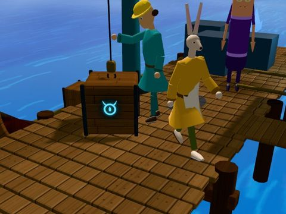 |
| 07 | 26.65–28.6 | 4 | worker | He reaches for and "sets down" the crate with nothing in his hands: the crate already stands on the pier, a metre away; he says his line walking away, back to us. 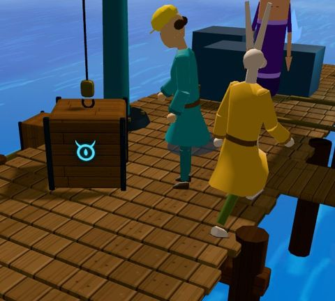 | `reach`/`setDown` played at a spot away from the crate; his walk overlaps his line. | **FIXED**: he steps to the crate's west face (he stood inside its footprint after #06), answers over his shoulder facing us, then bends and puts his hand on the crate's top as it settles (the thump, 27.0) and watches the hook go up. The scene's new pose layer (`bend`, opening.js) adds the extra bend `setDown` lacks for a 0.82 m crate: hand 7 cm over the top at the wrist, the feet stay down (ankles 0.07–0.09 m). Shot 4 now looks from the ferry's side and the resident stands clear of the crate after the drill's cutaway, so both speakers are seen. 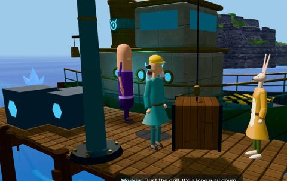 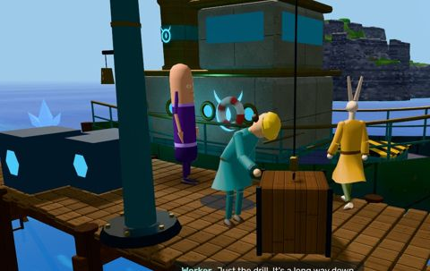 |
| 08 | 29–35, 48–53.4, 66.5–75.2 | 5, 7, 11 | Twinsen | His tunic's hem dips under the table edge. 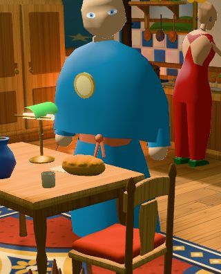 | He stands 0.35 m from the table's collider; the tunic is wider. | OPEN |
| 09 | 31.2–35 | 5 over Arthur's shoulder | Arthur | Arthur's face is never seen: "Dad! The mast fits!" comes from a spiky hair shape at the bottom edge (OPEN-2 leftover). 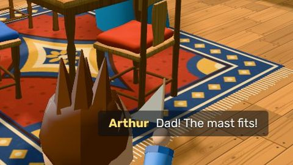 | The camera is behind and above his head. | **FIXED**: his line now has its own three-quarter close-up (31.2–33.1, from the west, the east wall of #10 behind him): his face, the mast held up toward his father, his eyes on him; the over-the-shoulder shot stays for Twinsen's answer (33.1–35). 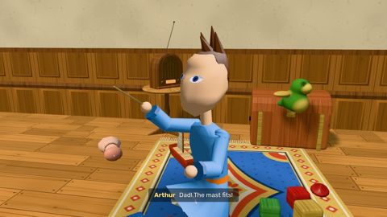 |
| 10 | 29–48, 53.4–62.4, 81.6–83.6 | 5, 6, 8, 9, 13 | camera | A black band over the house's walls at the top of the frame (OPEN-2 leftover). 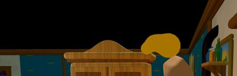 | The camera sees over the low walls into the empty space around the room. | **FIXED**: for the scene the house gets a ceiling and its east wall back (`openingSet`: four boxes through the props Kit so the plaster and panelling tile like the house's own walls; no shadows cast; in the room's group, so hidden with it outdoors). They fade out as the handoff's camera rises into the game's open-set view (83.6–84.0) and finish() removes and disposes them, played or skipped. No black above or beside the walls in shots 5–13 (1 s samples, 29–88). 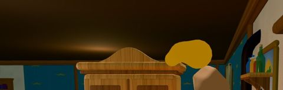 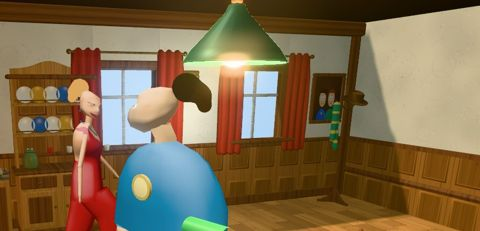 |
| 11 | 35–44, 58–60 | 6, 9 | Zoé | In profile her hair bun floats off the back of her head, with bare scalp between. 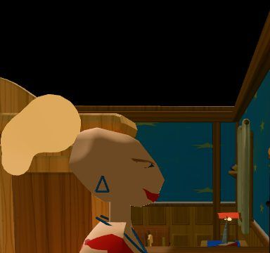 | The model (assets/poly/zoe.json): the bun is a shell that stands off the scalp. | NEEDS-MODEL |
| 12 | 45.4–47.9 | 6 the tap | Zoé | "Twinsen. The tap's stopped again." with her arm swung out over the stove: an empty gesture. 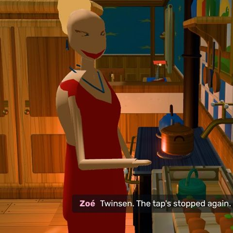 | The generic talk gesture, while she is calling across the room. | **FIXED**: she turns from the tap toward him (44.75, stepping round) and calls him without waving, arms at her sides (`say(..., false)` + the pose layer's arms-in from 45.0). `say` can now also pick a gesture by number instead of the rig's random one. 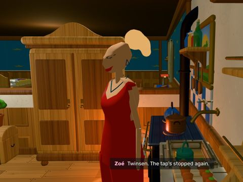 |
| 13 | 48.3–50.8 | 7 the exchange | Twinsen | He answers her facing the lens, his head turned as far as it goes: she is behind him. 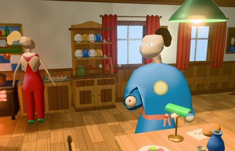 | He keeps facing south (the table) and only `lookAt` her; the head's turn is clamped at 1.1 rad. | **FIXED**: he turns round from the lamp to her (46.35–47.1, stepping round with the gameplay turn) and back to Arthur when Arthur speaks (54.9); shot 7 now looks from the west, so his face is seen, in three-quarter profile, looking at her. The black corner top right is item 10. 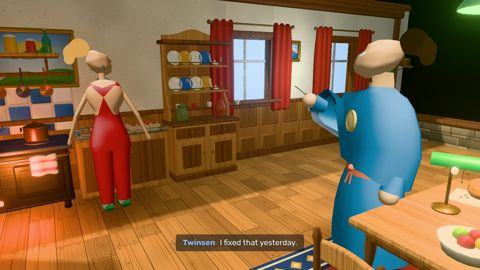 |
| 14 | 48–50.6 | 7 | Zoé | Back to him while he answers, both arms held out stiffly from her sides. 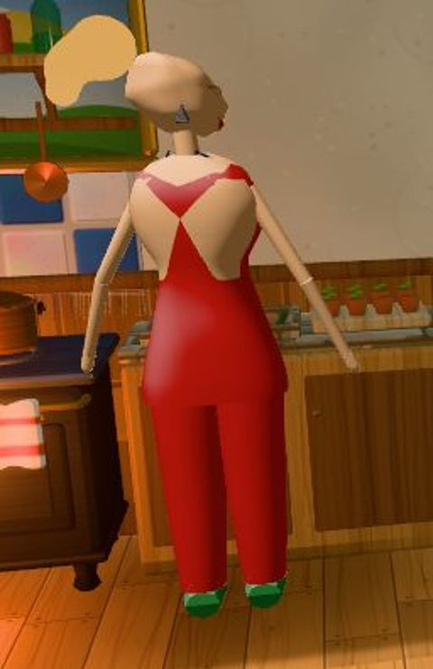 | She turns only at 50.6; the plain idle. | **FIXED**: she turns to him as her line ends (47.7, stepping round) and listens (`listen`), her arms brought in to her sides by the scene's pose layer for 47.7–58 (the idle's arms stand off her body: the model part is in #28). 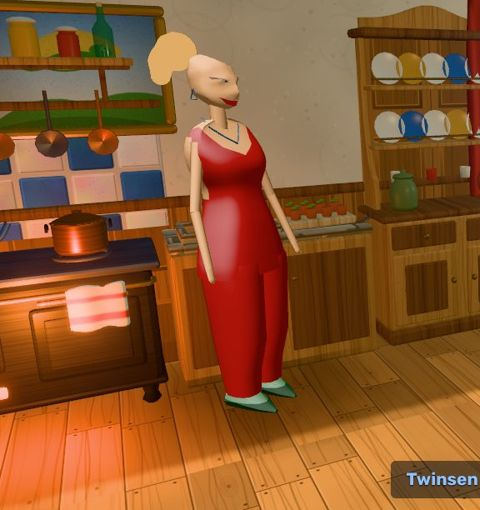 |
| 15 | 50.8–53.4 | 7 over his shoulder | Twinsen | His bald head fills a third of the frame; his shrug (53.0) is out of the picture. 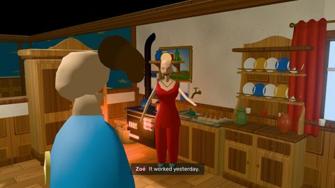 | The over-the-shoulder offset is 0.7 m to the side, 1.45 m behind, at his head's height. | OPEN |
| 16 | 55–57.9 | 8 the house hums | Arthur | Arthur's longest line ("Lulu says...") is said with his back to us at the bottom edge, his head under the subtitle; "all three look up" can't be read. 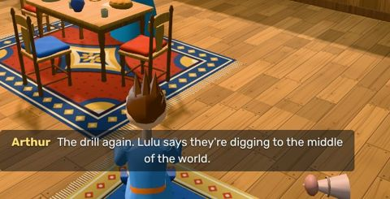 | The wide shot of 29 s reused, from behind Arthur. | **FIXED**: a new wide from the bed's foot holds all three as the dust falls from the ceiling and they look up (53.4–55); then Arthur's close-up (his first line's angle) for "The drill again..." while his parents turn to him (55–58). 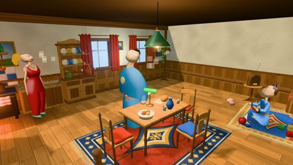 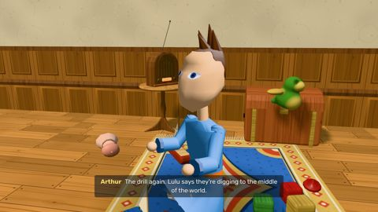 |
| 17 | 55.0–57.9 | 8 | subtitle | 70 characters in 2.9 s (24 a second): too fast to read. 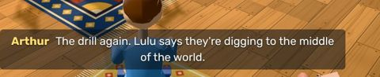 | The line's duration. | **FIXED**: 54.83–58.63 (3.8 s, 18 characters a second; logged from the page's subtitle element), starting with the cut to his close-up (now 54.8) and running on 0.6 s over the cut to the tap; his voice is paced over the longer line. 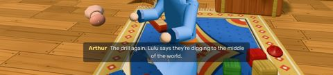 |
| 18 | 60.1–62.4 | 9 close | Zoé | "That's warm." while her hand is up at the tap's pipe, nowhere near the stream: the close-up shows the watering can. 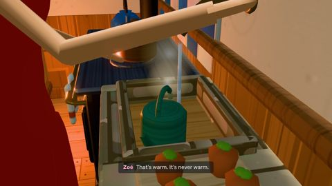 | `touchWater` puts the hand at chest height; she stands 0.3 m off the spout's line. | **FIXED**: she stands 0.12 m further west at the sink (clear of the stove) and the scene's pose layer brings the right arm in and down, the body leaning a little: the wrist measured at (-2.27, 1.06, -3.21) house-local, under the spout at (-2.30, 1.17, -3.23) and over the watering can's handle; in the close-up her fingers are in the stream. 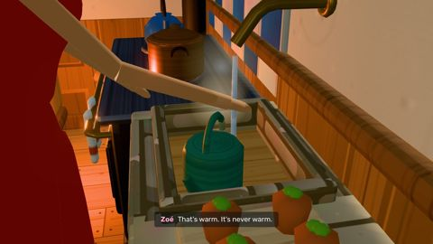 |
| 19 | 59.4–59.9 | 9 | Zoé | Her hand sweeps down into the watering can as she lets go of the tap. 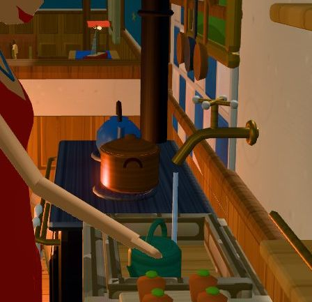 | `tapTurn` → `idle` drops the arm straight through the basin. | **FIXED**: her hand stays on the tap while she looks at the water, then goes straight from the tap to the stream (`from()`: the action entered at its held pose, so the joints ease there from where they are instead of winding up from arms-down). Measured path 60.0–60.3: (-1.94, 1.46, -3.10) → (-2.27, 1.05, -3.21), never lower than 1.05 (the can's top 0.95, its handle 1.02). 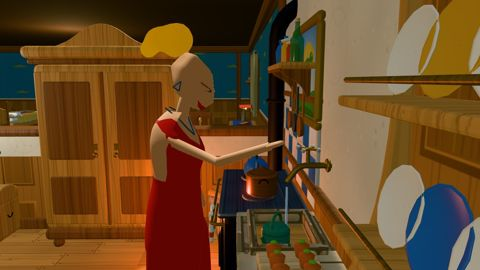 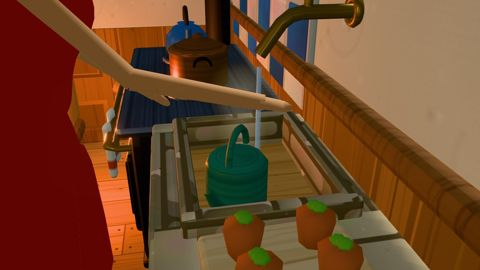 |
| 20 | 62.4–66.5 | 10 under the island | camera | The cave: crystals fill the foreground, the glowing vein (the point of the shot) can't be read, black void top right (OPEN-2 leftover). 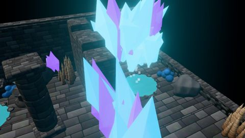 | The framing. | OPEN |
| 21 | 66.6–67.1 | 11 the decision | Twinsen | The screwdriver jumps from his hand to the table: his hand reaches toward the lamp, not to where it lands. 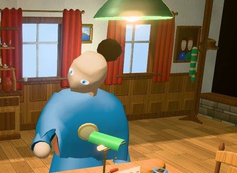 | `setDown` reaches straight ahead; the screwdriver is re-parented at its rest spot. | OPEN |
| 22 | 72.4–73.6 | 11 | Zoé | "Take your magic ball. Just in case." is said while she is hidden behind Twinsen. 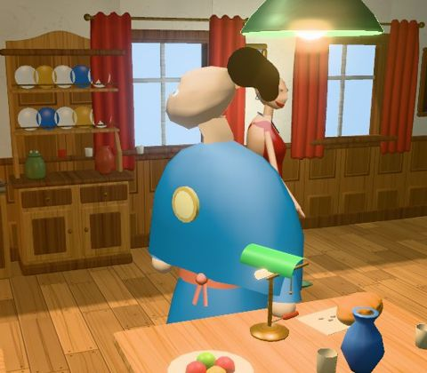 | Her walk passes behind him, in the camera's line, as she speaks. | **FIXED**: a cut at 72.2 to a camera by the east wall (#10's): she comes toward us past him, face to camera, through the whole line; he turns his head to her. (From the first camera she was behind him 72.4–73.4, computed and seen.) 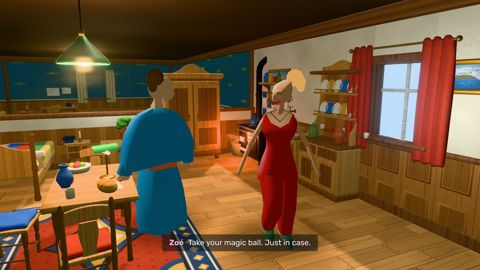 |
| 23 | 74.3–74.8 | 11 | Zoé | She walks through the chair by the table. 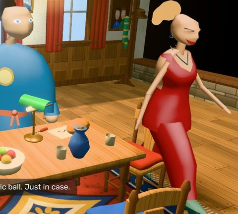 | The walk's corner hx(0.7, -1.4) → hx(1.2, 2.6) passes inside the chair's collider. | **FIXED**: the corner moved to hx(1.15, -1.2) → hx(1.25, 2.6), 0.35 m wide of the chair; no solid crossed in the per-frame log (was 74.30–74.83). 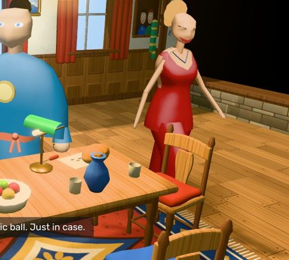 |
| 24 | 74.5–75.2 | 11 | Zoé | She walks into the lens and out of the frame's right edge, head cut, just before the cut. 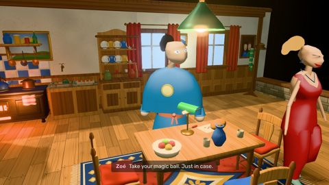 | The camera stands on her way to the hall. | OPEN |
| 25 | 77.2–78.0 | 12 outside | Zoé | She walks through the neighbours' picket fence (the user's report). 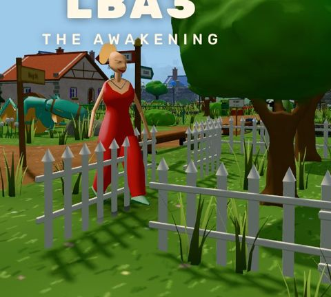 | A straight line from the door to the neighbours' door: it crosses the yard's fence and would go through their house. | **FIXED**: her walk goes round the yard's fence and the neighbours' house (north of the pickets, past their tree, to their door); the per-frame log has no solid crossed outside (was 77.20–77.97). The framing it leaves is item 26. 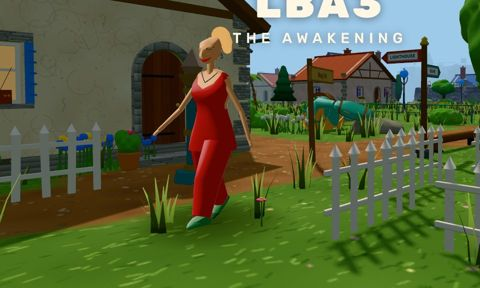 |
| 26 | 79–81.6 | 12 | camera | The title shot ends on the neighbours' bare side wall; Zoé is small, behind a fence, at the left edge. 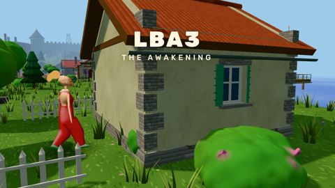 | The camera follows the straight-line walk. | **FIXED**: a new framing from the lane's far side (clear of the trees): she steps out by the heat post, comes up the path, turns along the lane past the fence and walks on to the neighbours' red roof; the pan keeps her right of centre and low so the title sits over the sky, not her head. 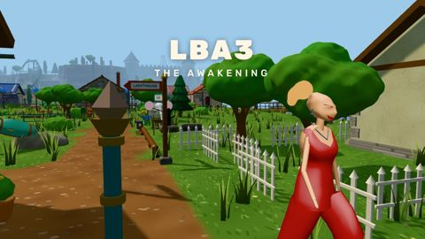 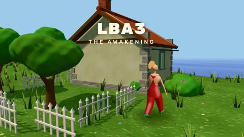 |
| 27 | 19.6–20.0 | 3 the drill | subtitle | The worker's line stays up 0.4 s into the drill shot. 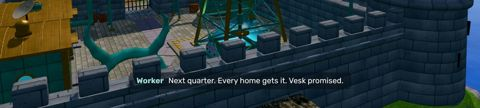 | The line ends at 20.0, the cut is at 19.6. | **FIXED**: the line runs 16.97–19.57 (2.6 s, 18 a second), right after the resident's; the drill shot opens on the hum alone. 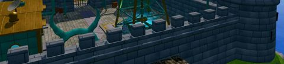 |
| 29 | 41.0–44.6, 58.0–60.0, 69.0–70.3 | 6, 9, 11 the tap | Zoé | Found while fixing 18–19: she turns the tap with her hand 0.36 m to the right of its handle, in the air (measured: hand (-1.94, 1.46, -3.10), handle (-2.30, 1.40, -3.35), house-local).  | `reach`/`tapTurn` raise the right arm straight forward from the shoulder, which is beside the tap, not in front of it. | **FIXED**: the pose layer brings the arm in and forward for each turn of the tap (41.0–44.7, 58.0–60.15, 69.0–70.35), and the twist and the release enter at their held pose (`from`), so the hand stays on the handle: the wrist measured within 0.1 m of the handle (-2.30, 1.40, -3.35) at 41.5–44.3, 58.4–59.4, 69.4–69.7 (it was 0.36 m to the side). Her short walk to the sink now ends before the reach (40.2 start: with #18's new spot it ended after it and reset her to idle). 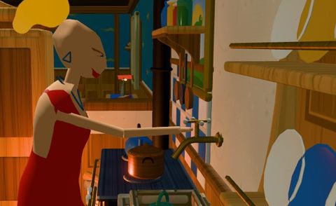 |
| 28 | all | all | Twinsen, Zoé | The characters' build: Twinsen's tunic is a wide bell with the hands lost in it, Zoé's arms are thin straight sticks, both heads read bald from behind.  | The poly cast's models. | NEEDS-MODEL |

Checked and not a bug: feet on the floor (ankles 7–12 cm over the floor standing, kneeling and in every action; no
sinking); no T-poses; no actor pops between frames outside a dip to black (tests/opening.mjs); props held in hands
stay attached (the screwdriver is on his hand at 32 s; the mast in Arthur's); the handoff (83.6–88) eases out
without a jump; captions and the title hold their timing.
